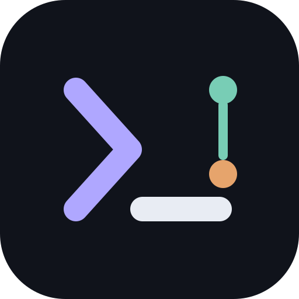
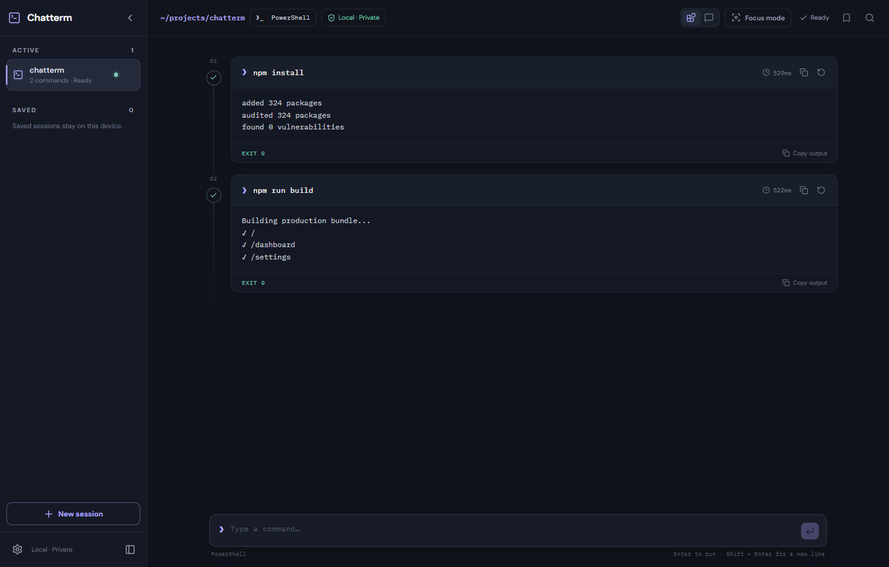

<div align="center">
  
  <h1>Chatterm</h1>
  <p><strong>Your terminal, with a memory.</strong></p>
  <p>A local-first terminal emulator that can read like a command thread, a conversation, or the focused terminal you already know.</p>

  [](https://github.com/temidayoxyz/chatterm/actions/workflows/ci.yml)
  [](https://github.com/temidayoxyz/chatterm/releases/latest)
  [](LICENSE)
</div>



## One terminal, three ways to work

- **Thread · Blocks** keeps every command, its output, exit status, and duration together on an execution rail.
- **Thread · Chat** shows the same session as an input/output conversation. It is a layout, not a separate shell.
- **Focus** is a full xterm-compatible surface for TUIs, REPLs, editors, pagers, SSH, and anything that needs direct terminal control.

All three views share one native pseudo-terminal process. Switching views never restarts the shell or loses its state. Alternate-screen applications can enter Focus automatically and return to Thread when they close.

## What ships in v0.1

- Native PTYs through ConPTY on Windows and Unix PTYs on macOS/Linux
- PowerShell, Windows PowerShell, Bash, Zsh, and Fish thread integration
- 24-bit color, keyboard input, resize, scrollback, selection, and search via xterm.js
- Explicit, local SQLite session saving—nothing is saved until you ask
- Basalt, Paper, and Classic themes with bundled offline fonts
- Bounded in-memory terminal history and 10,000-line Focus scrollback
- No account, cloud sync, analytics, telemetry, advertising, or built-in AI
- Strict Tauri permissions and Content Security Policy

## Install

Download the latest package from [GitHub Releases](https://github.com/temidayoxyz/chatterm/releases/latest):

| Platform | Package |
| --- | --- |
| Windows 10/11 | `.msi` or setup `.exe` |
| macOS Apple silicon | `.dmg` for `aarch64` |
| macOS Intel | `.dmg` for `x86_64` |
| Linux x86_64 | `.AppImage` and `.deb` |

The community builds are currently unsigned. Windows SmartScreen and macOS Gatekeeper may therefore ask for confirmation. See [release notes](RELEASE_NOTES.md) for platform-specific details.

## Build from source

You need Node.js 24+, Rust stable, and the [Tauri 2 system prerequisites](https://v2.tauri.app/start/prerequisites/).

```bash
git clone https://github.com/temidayoxyz/chatterm.git
cd chatterm
npm ci
npm run verify
npm run tauri dev
```

Build the installer for your current operating system:

```bash
npm run tauri build
```

Linux contributors also need WebKitGTK 4.1, AppIndicator, librsvg, and `patchelf`. Exact setup and verification commands are in [docs/DEVELOPMENT.md](docs/DEVELOPMENT.md).

## Keyboard

| Shortcut | Action |
| --- | --- |
| <kbd>Ctrl/Cmd</kbd> + <kbd>N</kbd> | New session |
| <kbd>Ctrl/Cmd</kbd> + <kbd>S</kbd> | Save current session locally |
| <kbd>Ctrl/Cmd</kbd> + <kbd>F</kbd> | Search commands/output |
| <kbd>Ctrl/Cmd</kbd> + <kbd>Enter</kbd> | Toggle Thread/Focus |
| <kbd>Ctrl</kbd> + <kbd>C</kbd> | Interrupt the active command |

## Privacy model

Chatterm is deliberately boring about data: terminal bytes travel from the local PTY to the local WebView over Tauri IPC. Saved sessions live in a local SQLite database. There are no network calls in the app, and browser-rendered output is always treated as text rather than HTML. Read the complete [privacy design](docs/PRIVACY.md) and [security policy](SECURITY.md).

## Project structure

```text
src/                         Svelte 5 interface and terminal protocol parser
src-tauri/src/               Rust PTY manager, Tauri commands, SQLite history
src-tauri/shell-integration/ Shell hooks for structured command boundaries
design/                      Product direction and early visual concepts
.github/workflows/           Cross-platform CI and release packaging
```

The detailed event and trust boundaries are documented in [docs/ARCHITECTURE.md](docs/ARCHITECTURE.md).

## Contributing

Issues and pull requests are welcome. Start with [CONTRIBUTING.md](CONTRIBUTING.md), follow the [Code of Conduct](CODE_OF_CONDUCT.md), and keep terminal behavior local and predictable. The roadmap lives in [GitHub Issues](https://github.com/temidayoxyz/chatterm/issues).

## License

[MIT](LICENSE) © 2026 Temidayo.
