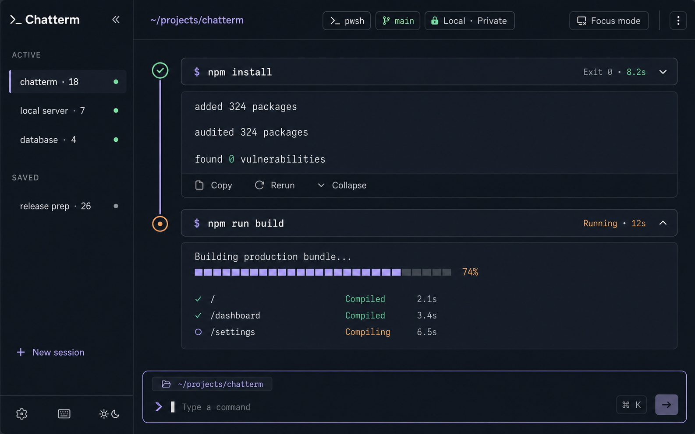
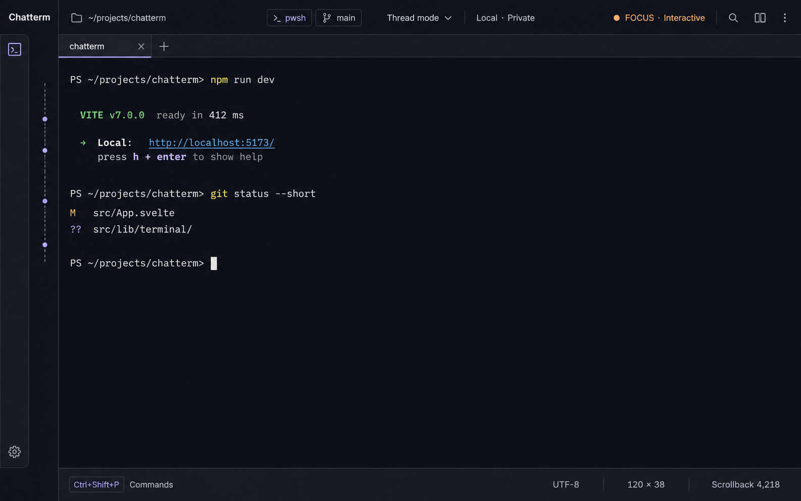
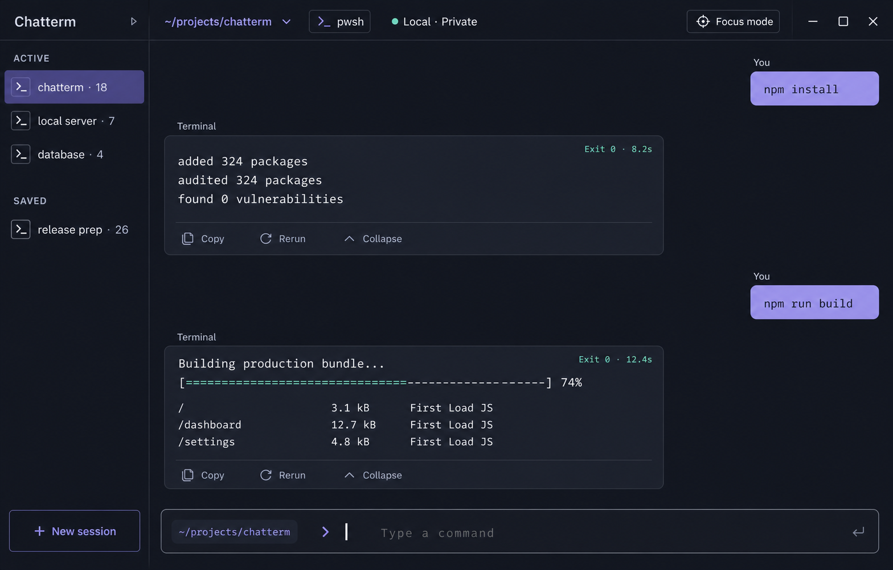

# Chatterm UI direction

## Design thesis

Chatterm is a terminal whose history reads like a conversation without pretending to be a messaging app.

The audience is developers and technical operators who already understand terminals but want command history to be easier to scan, revisit, and act on. The interface's single job is to make the relationship between a command, its live process, and its resulting output immediately legible while preserving genuine terminal behavior.

The shell remains the source of truth. Chatterm never rewrites raw output unless a program explicitly emits a trusted structured-output payload.

## Product modes

Thread and Focus are two views of the same PTY session.

### Thread mode

Thread mode is the default shell experience:

- Commands and output are grouped into execution blocks.
- Completed output becomes a stable, searchable block.
- The current block remains a live terminal surface.
- Command metadata can show working directory, exit status, duration, and time.
- Actions such as Copy, Rerun, Collapse, and Save appear only when relevant.



### Focus mode

Focus mode is an uninterrupted, conventional terminal grid:

- It is available manually at any time.
- Chatterm enters it automatically for alternate-screen applications such as Vim, `top`, and `less`.
- The session sidebar collapses to a narrow rail.
- Previous command locations remain visible as quiet markers in an overview rail.
- When an interactive program exits, Chatterm can return to Thread mode.



## Signature: the execution rail

A thin vertical signal trace runs alongside a Thread-mode session. Each command receives a node whose state is semantic:

- Lavender: selected or ready.
- Copper: running or awaiting input.
- Sea Glass: successful completion.
- Red: failed or terminated.
- Gray: unavailable metadata or detached shell integration.

This rail is structural rather than decorative. It connects a command to its output, supports command-to-command navigation, and becomes the command-marker overview in Focus mode.

## Why execution blocks are better than speech bubbles

The original left/right chat-bubble proposal clearly communicates "conversation," but it introduces several problems:

- Right-aligned commands waste horizontal space.
- Large terminal output does not fit naturally inside a speech bubble.
- Repeated "You" and "Terminal" labels add noise.
- Speech tails and avatars make a serious terminal feel like a chatbot.
- Interactive programs do not map cleanly to a sequence of immutable messages.

Execution blocks preserve the conversational rhythm while remaining suitable for logs, tables, stack traces, progress displays, and interactive processes. A compact command header sits directly above a full-width output surface, so the relationship remains obvious without labels.

### Literal chat alternative

The original proposal was also explored directly, using right-aligned command bubbles and left-aligned terminal replies:



This treatment is approachable and immediately communicates the product premise. It could work as an optional relaxed theme. The execution-block direction is still recommended as the default because it uses width more efficiently, creates a stronger relationship between command and output, and scales more naturally to dense professional workflows.

## Visual system

### Color

| Token | Value | Use |
| --- | --- | --- |
| Basalt | `#10131B` | Main canvas |
| Graphite | `#181D28` | Sidebar and application chrome |
| Carbon | `#222737` | Command and output surfaces |
| Fog | `#E8ECF3` | Primary text |
| Lavender | `#AFA7FF` | Selection, execution rail, keyboard focus |
| Copper | `#E6A46C` | Running and waiting states |
| Sea Glass | `#78CDB5` | Successful completion |
| Signal Red | `#E47F86` | Failure and termination |

The palette deliberately avoids pure black, neon green, and a single-accent "cyber terminal" treatment. Terminal ANSI colors remain configurable by the active theme.

### Typography

- UI and navigation: Spline Sans, variable weight.
- Commands and terminal output: Iosevka Term.
- Terminal font is user-configurable; layout must not depend on Iosevka-specific metrics.
- Metadata uses the UI face at a small size rather than shrinking terminal text excessively.

### Shape and spacing

- Output blocks use restrained 10–12 px corners.
- Command headers are attached to their output, not floating pills.
- Hairline borders separate state; shadows are minimal.
- The main thread is wide enough for real output and capped only on very large displays.
- Animation is limited to one orchestrated behavior: a command node activates, the command header settles into the rail, and the live output surface opens beneath it.

## Layout

### Thread mode

```text
┌──────────── session ledger ────────────┬──────────── workspace / shell / privacy ────────────┐
│ ACTIVE                                 │                                                     │
│ ● chatterm · 18                        │  ✓ ─ command header ─────────── Exit 0 · 8.2s        │
│ ● local server · 7                     │  │  raw terminal output                             │
│ ● database · 4                         │  │  block actions                                   │
│                                        │  ◉ ─ running command ───────── Running · 12s        │
│ SAVED                                  │  │  live terminal surface                           │
│ ○ release prep · 26                    │  │                                                  │
│                                        │  └─ terminal-native input surface                   │
│ + New session                          │                                                     │
└────────────────────────────────────────┴─────────────────────────────────────────────────────┘
```

### Focus mode

```text
┌──┬──────────────────────────── workspace / mode / status ────────────────────────────────────┐
│  │ terminal tab                                                                            │
│  ├─────────────────────────────────────────────────────────────────────────────────────────┤
│  │ ·│                                                                                      │
│  │ ·│  uninterrupted terminal grid                                                         │
│  │ ·│                                                                                      │
│  │  │                                                                                      │
│  ├─────────────────────────────────────────────────────────────────────────────────────────┤
│  │ shortcuts                                             UTF-8 · dimensions · scrollback   │
└──┴─────────────────────────────────────────────────────────────────────────────────────────┘
```

## Interaction rules

1. Input is terminal-native. Keystrokes go to the PTY as they are typed; the interface does not wait for Enter and then submit a synthetic command.
2. A command becomes a block only after shell integration confirms its execution boundary.
3. Without shell integration, the session remains fully usable and falls back to an ungrouped terminal view.
4. Carriage returns, progress indicators, cursor movement, and ANSI styles update the current live surface rather than appending duplicate lines.
5. Completed blocks can be virtualized and frozen into styled terminal rows for efficient scrollback.
6. Alternate-screen entry triggers Focus mode by default. The user can disable automatic switching.
7. Closing an unsaved session destroys its history after confirmation when a foreground process is still running.
8. Saving is explicit and visibly changes the session state. Chatterm never implies that ephemeral sessions are persisted.

## Interface copy

- Use "New session," not "New conversation."
- Use "Thread mode" and "Focus mode."
- Use "Running," "Waiting for input," "Interrupted," and "Exit 1" for process state.
- Reserve personalized greetings for the first-run empty state.
- Empty state: "Start with a command."
- Privacy indicator: "Local · Private."
- Avoid assistant language such as "How can I help?"

## Structured output

Structured cards are a post-v1 enhancement. Raw terminal output is always available and remains the fallback.

When implemented:

- Accept only an allowlisted, versioned JSON schema.
- Render data using native Chatterm components, never arbitrary HTML.
- Apply strict payload and nesting limits.
- Make card actions explicit and non-executing by default.
- Provide a one-click "View raw output" control.

## Design critique and revision

The initial visual direction risked becoming the familiar near-black interface with one bright accent. It was revised by:

- Giving Lavender, Copper, and Sea Glass separate semantic jobs.
- Making the execution rail the single memorable visual risk.
- Removing chat avatars, message tails, decorative gradients, and floating glass cards.
- Keeping terminal surfaces quiet and dense so the rail—not decoration—carries the identity.

## Generated concept prompts

Both concepts were generated with the built-in image generation tool using the `ui-mockup` use case.

- Thread mode: high-fidelity 16:10 desktop UI with a session ledger, workspace bar, full-width execution blocks, vertical status rail, live build output, and terminal-native input.
- Focus mode: matching high-fidelity 16:10 desktop UI with a collapsed session rail, command-marker overview, uninterrupted terminal grid, real PowerShell output, and terminal status strip.
- Literal chat alternative: matching high-fidelity 16:10 desktop UI with right-aligned command bubbles, wide left-aligned terminal responses, session ledger, and terminal-native input.

The images are product-direction artifacts. Exact typography, alignment, controls, and terminal behavior should be implemented and validated in code rather than copied pixel-for-pixel from generated text.
