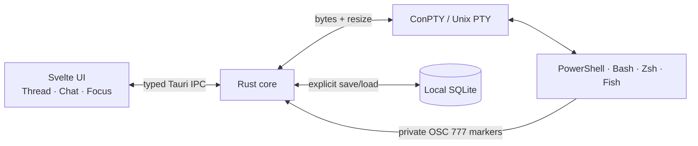

# Architecture

Chatterm is a Tauri 2 desktop application with a Svelte 5 WebView and a Rust native core.

## Terminal lifecycle

1. The UI asks Rust for discovered shell profiles.
2. Rust creates a native PTY, launches the selected shell, and returns session metadata.
3. A Tauri channel streams byte arrays to the UI; input and resize requests travel back through commands.
4. A streaming parser removes Chatterm’s private OSC markers while preserving their exact order relative to visible output.
5. Visible bytes feed the bounded raw buffer used by Focus. Command-bound output also feeds the current Thread block as escaped text.
6. The shell process is killed when its session closes or the terminal manager is dropped.

## Private shell protocol

Chatterm uses Operating System Command sequence `777`, terminated by BEL or ST:

| Marker | Meaning |
| --- | --- |
| `A;<cwd>` | Prompt begins; includes current working directory |
| `B` | Prompt ends |
| `C;<command>` | Command begins |
| `D;<exit-code>` | Command ends |

The parser supports arbitrary byte-chunk boundaries. Markers never reach xterm.js or saved output.

## View model

Blocks and Chat are layouts over `CommandBlock[]`. Focus replays and follows the same session’s visible raw byte chunks in xterm.js. The application watches alternate-screen control sequences (`47`, `1047`, and `1049`) to enter/leave Focus without changing the underlying PTY.

## Persistence

`HistoryStore` owns one SQLite connection protected by a mutex. WAL mode and foreign keys are enabled. `saved_sessions` owns ordered `saved_blocks`; replacing a save runs in one transaction and deletion cascades. No live session is persisted automatically.

## Security properties

- Tauri exposes only seven narrow commands and `core:default`; there is no shell/HTTP/filesystem plugin.
- CSP denies remote resources, objects, frames, and forms.
- Terminal output is rendered through text nodes or xterm.js, never `innerHTML`.
- Raw in-memory history is capped at 12 MiB per session.
- SQLite statements are parameterized.
